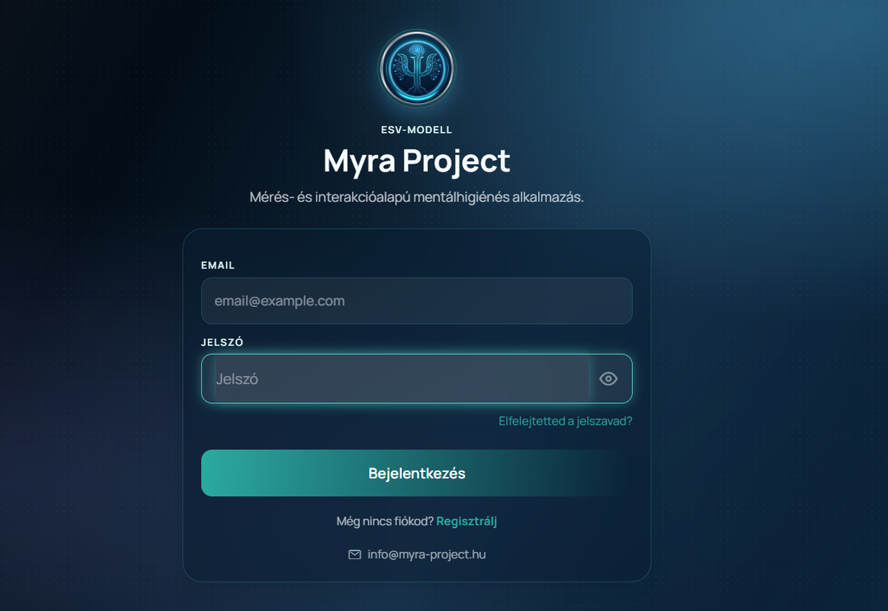
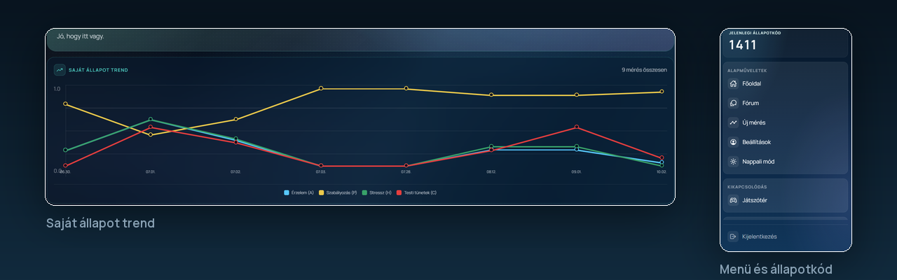

# Myra Project

https://myra-project.hu

Önismereti platform: ESV-modell alapú állapotfelmérés, méréshez kötött chat, naplózott
krízisjelzés.





## Architektúra

```
böngésző → Caddy (TLS, WAF) → FastAPI backend → PostgreSQL + pgvector
                                            → LLM (Gemini API vagy helyi llama-server)
```

- **Backend:** FastAPI, SQLAlchemy async, asyncpg
- **Adatbázis:** PostgreSQL 17 + pgvector (1024 dimenziós embedding)
- **Frontend:** Expo / React Native Web, statikus export
- **Fordított proxy:** Caddy, Coraza WAF-fal (OWASP CRS)
- **Konténerek:** Docker Compose

## Indítás

```bash
cp .env.example .env      # töltsd ki a TITOK jelölésű sorokat
docker compose up -d --build
```

A backend a `127.0.0.1:8001`-en figyel, a Caddy proxyzza. Az adatbázis inicializálásához
és a vektoros indexekhez lásd a `docker-compose.yml` megjegyzéseit.

## Konfiguráció

Minden beállítás a `.env`-ben van; a `.env.example` a sablon. Titkot (kulcs, jelszó,
token) **soha** ne commitolj — a `.gitignore` és a `.env.example` ezt hivatott védeni.

## Biztonság

- jelszavas belépés + e-mailes MFA, adminnál kötelező
- rate limit, brute-force védelem, audit napló
- krízisjelzés három rétegben (előszűrő → modell → determinisztikus padló)
- a helyi LLM csak a WireGuard-hálózaton érhető el

## Licenc

PolyForm Noncommercial 1.0.0 — nem kereskedelmi használat a licenc és a
szerzői megjelölés megtartásával. Kereskedelmi használat kizárólag
írásos engedéllyel: info@myra-project.hu

A teljes licencszöveg: [LICENSE](LICENSE).

## Támogatás

A projekt nem kereskedelmi célra ingyenesen használható. Ha hasznosnak
találod, itt tudod támogatni a fejlesztést:

[☕ Ko-fi](https://ko-fi.com/antalodor)

## Kapcsolat

info@myra-project.hu
